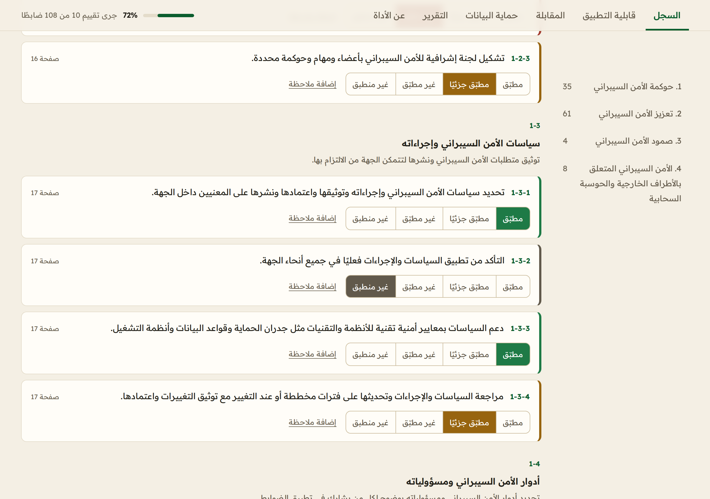
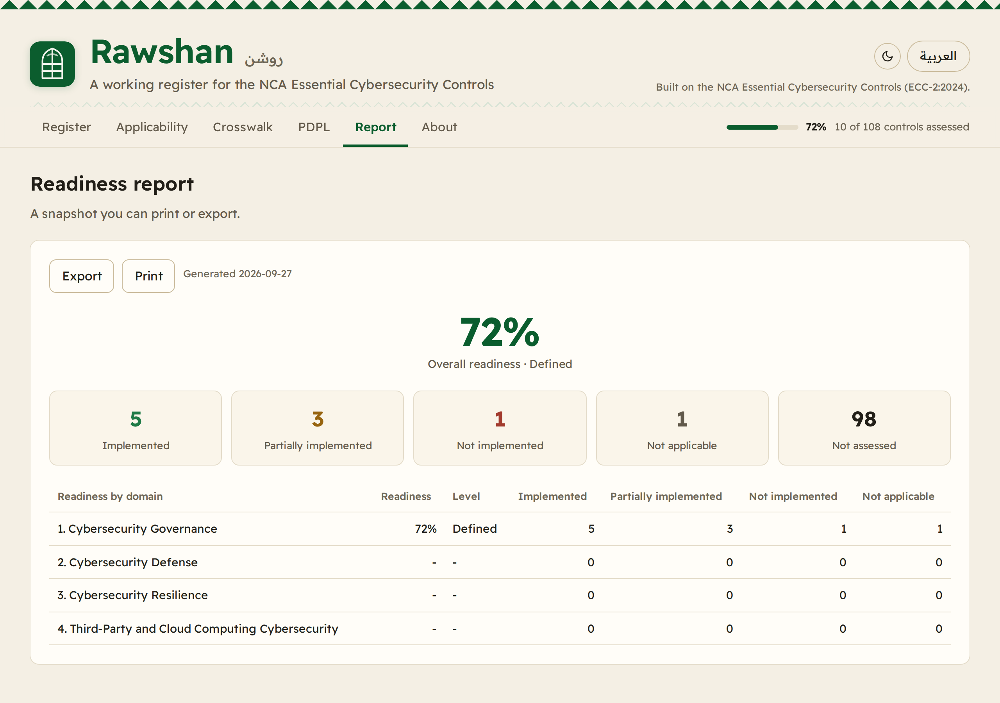

# Rawshan

A working register for Saudi Arabia's **Essential Cybersecurity Controls** (ECC-2:2024), issued by the National Cybersecurity Authority (NCA). Work through all 108 controls across the four domains, set each one's status, and watch readiness roll up by domain and overall with a maturity band. It includes an applicability guide to the wider NCA control families, a crosswalk to ISO 27001 and the NIST Cybersecurity Framework 2.0, the core Personal Data Protection Law obligations, and an MCP server so AI agents can use the same data.

Site: https://rawshan.3li.info

Arabic follows below. [بالعربية](#بالعربية)



## What it does

- **Walks the register.** All 108 controls across the 4 domains and 28 subdomains, each with an English and Arabic summary and a link to its page in the NCA document. You set each control to implemented, partially implemented, not implemented or not applicable, and add notes.
- **Reports readiness.** Implemented counts as full, partial as half, not applicable is set aside. Rawshan computes readiness per domain and overall and maps it to a maturity band from initial to managed.
- **Guides applicability.** The Essential Cybersecurity Controls are the baseline. The applicability tab shows who the other NCA families apply to, so you know when the Critical Systems, Operational Technology, Cloud, Data or Telework controls come on top.
- **Crosswalks.** Every subdomain mapped to ISO 27001 and NIST CSF 2.0 references, searchable in both directions.
- **Covers the PDPL.** The core obligations from the Saudi Personal Data Protection Law that sit beside the controls.
- **Exports.** A printable readiness report and an assessment file you can save and reopen.

Everything runs in the browser. There is no server, no account and no tracking, and the assessment never leaves the device unless you export it.



## How readiness is worked out

Each control carries a status. Readiness is the score over the controls you have assessed, ignoring the ones you mark not applicable.

| Status | Score |
| --- | --- |
| Implemented | 1 |
| Partially implemented | 0.5 |
| Not implemented | 0 |
| Not applicable | set aside |

The percentage maps to a maturity band: initial below 30, developing from 30, defined from 60, managed from 85. The same rollup runs per domain and overall.

## Sources and provenance

| Source | Used for |
| --- | --- |
| NCA Essential Cybersecurity Controls, ECC-2:2024 | Control IDs, domain and subdomain titles, page numbers |
| Saudi Personal Data Protection Law (PDPL) | The data protection obligations |
| NIST Cybersecurity Framework 2.0 | One side of the crosswalk |
| ISO/IEC 27001 | The other side of the crosswalk |
| NCA National Cryptographic Standards | Referenced by the cryptography controls |

The repository does not copy the NCA's wording. Control IDs, titles and page numbers follow the NCA official English text. The summaries, the crosswalk and the notes are this project's own work, written from the official text as intent, and are kept apart from the official text. Rawshan is independent and is not affiliated with or endorsed by the NCA.

## MCP server

The server has no dependencies and works offline from the bundled data.

```sh
npx -y github:SiteQ8/Rawshan
```

Add it to any MCP client:

```json
{
  "mcpServers": {
    "rawshan": { "command": "npx", "args": ["-y", "github:SiteQ8/Rawshan"] }
  }
}
```

From a clone, `node mcp/server.mjs` does the same.

| Tool | What it returns |
| --- | --- |
| `ecc_overview` | The four domains, counts and official sources |
| `ecc_list_domains` | The 4 domains with subdomain and control counts |
| `ecc_list_subdomains` | The 28 subdomains with titles, objectives and counts |
| `ecc_get_control` | One control: summary, subdomain, official page and mappings |
| `ecc_search_controls` | Controls matching words in English or Arabic, by domain |
| `ecc_crosswalk` | ECC subdomain to ISO 27001 and NIST CSF 2.0, or the reverse |
| `ecc_pdpl_obligations` | The core PDPL obligations, by keyword |
| `ecc_families` | The NCA control families and who each applies to |
| `ecc_readiness_report` | Readiness, bands and a prioritized gap list for a saved assessment |
| `ecc_sources` | The official sources and the provenance note |

All tools are read-only and return both Markdown and structured JSON. `npm run selftest` exercises them without a client.

## About the name

Rawshan (روشن) is the carved wooden lattice window of old Hijazi houses, a screen of fine geometric order that lets people see out while keeping the inside protected. A fitting name for a register that gives you a clear view of your controls.

## Development

```sh
npm run build       # assemble docs/data/bundle.json from data/src
npm run check       # fail if the committed bundle is out of date
npm test            # the test suite
npm run preflight   # build, guards and tests together
npm run mcp         # start the MCP server
```

The site is plain HTML, CSS and JavaScript under `docs/`, served by GitHub Pages. The data lives in `data/src/` as small JSON files and is compiled into a single `bundle.json` that both the site and the server read.

## License

Open source under the MIT license. The Essential Cybersecurity Controls belong to the NCA. Readex Pro is used under the SIL Open Font License. See `LICENSE` and `NOTICE.md`.

---

## بالعربية

روشن سجل عمل لضوابط الأمن السيبراني الأساسية في المملكة العربية السعودية الصادرة عن الهيئة الوطنية للأمن السيبراني بالإصدار ECC-2 لعام 2024. يمكّنك من العمل على الضوابط الثمانية بعد المئة عبر المكوّنات الأربعة وتحديد حالة كل ضابط ومتابعة الجاهزية بحسب المكوّن وإجماليًا مع مستوى نضج. يضم الأداة دليلًا لقابلية تطبيق عوائل ضوابط الهيئة ومقابلة لمعيار ISO 27001 وإطار الأمن السيبراني من NIST والتزامات نظام حماية البيانات الشخصية وخادم MCP لوكلاء الذكاء الاصطناعي.

الموقع على الرابط https://rawshan.3li.info

### ما الذي تقدمه

- **استعراض السجل.** جميع الضوابط الثمانية بعد المئة عبر أربعة مكوّنات وثمانية وعشرين مكوّنًا فرعيًا مع ملخص بالعربية والإنجليزية لكل ضابط ورابط لصفحته في وثيقة الهيئة حيث تحدد لكل ضابط حالة مطبّق أو مطبّق جزئيًا أو غير مطبّق أو غير منطبق وتضيف ملاحظاتك.
- **تقرير الجاهزية.** يُحتسب المطبّق كاملًا والجزئي نصفًا ويُستبعد غير المنطبق ثم يحسب روشن الجاهزية بحسب المكوّن وإجماليًا ويربطها بمستوى نضج من مبدئي إلى مُدار.
- **دليل قابلية التطبيق.** الضوابط الأساسية هي الأساس ويبيّن قسم قابلية التطبيق لمن تنطبق عوائل الهيئة الأخرى حتى تعرف متى تنضاف ضوابط الأنظمة الحساسة والأنظمة التشغيلية والحوسبة السحابية والبيانات والعمل عن بُعد.
- **المقابلة.** يقابل كل مكوّن فرعي مع مراجع ISO 27001 وإطار NIST مع بحث في الاتجاهين.
- **حماية البيانات.** الالتزامات الأساسية من نظام حماية البيانات الشخصية السعودي إلى جانب الضوابط.

كل شيء يعمل داخل المتصفح دون خادم ولا حساب ولا تتبع ولا تغادر بياناتك جهازك إلا إذا صدّرتها.

### كيف تُحتسب الجاهزية

يحمل كل ضابط حالة والجاهزية هي مجموع النقاط على الضوابط التي قيّمتها مع استبعاد ما وسمته غير منطبق. المطبّق نقطة كاملة والجزئي نصف نقطة وغير المطبّق صفر. تُترجم النسبة إلى مستوى نضج مبدئي دون ثلاثين ثم قيد التطوير من ثلاثين ثم محدّد من ستين ثم مُدار من خمسة وثمانين.

### المصادر والإسناد

الضوابط ملك للهيئة الوطنية للأمن السيبراني حيث تستند معرّفات الضوابط وعناوينها وأرقام صفحاتها إلى النص الإنجليزي الرسمي أما الملخصات والمقابلة والملاحظات فهي عمل خاص بهذا المشروع مكتوب من النص الرسمي بوصفه المقصد ومفصول عنه. روشن أداة مستقلة لا ترتبط بالهيئة ولا تحظى باعتمادها.

### عن الاسم

روشن هو النافذة الخشبية المشغولة في البيوت الحجازية القديمة وهي مشربية بنظام هندسي دقيق تتيح النظر إلى الخارج وتحفظ الداخل لذا جاء الاسم مناسبًا لسجل يمنحك رؤية واضحة لضوابطك.

### الترخيص

مفتوح المصدر بترخيص MIT والضوابط الأساسية ملك للهيئة الوطنية للأمن السيبراني.
